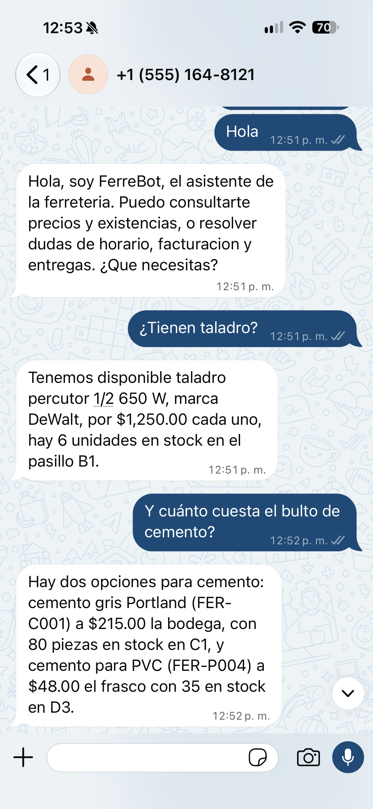

# Agentes de IA con Llama y WhatsApp

Portafolio de los proyectos que desarrollé durante el programa **IA Aplicada con Modelos Llama** (CPFIA–INFOTEC, en colaboración con Meta). Son cinco agentes conversacionales construidos de cero, desde la comparación de modelos y el fine-tuning hasta un agente funcional conectado a WhatsApp con herramientas reales, capas de seguridad y métricas de operación.

El hilo que une todo es una idea: **un modelo de lenguaje no debe ser la fuente de verdad**. En cada proyecto los datos viven en estructuras que el código controla, y el modelo se limita a entender la pregunta, elegir la herramienta y redactar la respuesta. Esa separación es lo que permite que un modelo de 8 000 millones de parámetros atienda clientes sin inventar precios ni existencias.

---

## Proyectos

| | Proyecto | Qué resuelve | Técnicas |
|---|---|---|---|
| 02 | [Ajuste de tono con LoRA](proyectos/02-challenge-ajuste-de-tono-lora/) | Enseña a un modelo ligero a responder en el estilo de la empresa | Fine-tuning con LoRA, dataset propio |
| 03 | [Agente de veterinaria](proyectos/03-challenge-agente-veterinaria/) | Agenda citas y detecta urgencias en una clínica veterinaria | Diseño conversacional, reglas de escalamiento |
| 04 | [Agente de taller mecánico](proyectos/04-agente-taller-mecanico/) | Consulta horarios disponibles y preguntas frecuentes por WhatsApp | Function calling, WhatsApp Cloud API |
| 05 | **[FerreBot — agente de ferretería](proyectos/05-hackathon-ferrebot/)** | Inventario en vivo y políticas de tienda, atendidos por WhatsApp | Function calling, RAG, Llama Guard, métricas |

El proyecto 05 es el más completo y el mejor punto de entrada si vas con poco tiempo.

---

## Destacado: FerreBot

Un agente de WhatsApp para una ferretería que atiende las dos preguntas que más interrumpen el mostrador: *¿tienen taladro?* y *¿hacen factura?*

<p align="center">
  
</p>

Las dos preguntas son de naturaleza distinta y por eso usan técnicas distintas. El precio y las existencias cambian con cada venta, así que se resuelven con **function calling** contra el inventario real. Las políticas viven en un documento y admiten mil formas de preguntarse, así que se resuelven con **RAG** sobre embeddings.

Lo que hace que no alucine está en el diseño, no en el modelo. El inventario es la única fuente de verdad y las funciones validan antes de actuar: piden lo que falta, rechazan una clave que no existe y nunca rellenan huecos. Una alucinación se queda en una validación fallida y no se convierte en un movimiento de almacén falso.

Hay además un hallazgo que salió de probarlo en WhatsApp con mensajes reales, y que está documentado dentro del notebook: el modelo calculaba bien una venta de \$555.00 pero la comunicaba al cliente como \$1,665.00. El error no estaba en el cálculo sino en la redacción. La corrección fue dejar de pedirle que repitiera cifras, y enviar el resultado de esas herramientas tal cual.

---

## Stack

**Modelos.** Llama 3.1 8B como modelo conversacional, Llama Guard 3 como clasificador de seguridad, BGE-M3 para embeddings multilingües y TinyLlama para los experimentos de fine-tuning.

**Infraestructura.** Ollama para servir los modelos, Llama Stack para la memoria de conversación y el protocolo de function calling, FastAPI para el webhook, ngrok para exponerlo y la WhatsApp Cloud API de Meta para la mensajería. Groq como proveedor de inferencia en los proyectos del primer módulo.

**Técnicas.** RAG con embeddings y umbral de similitud calibrado, function calling con validación previa a la ejecución, fine-tuning con LoRA, moderación de contenido en entrada y salida, detección de inyección de prompt, y registro de métricas de volumen, latencia y tasa de error.

---

## Cómo ejecutarlos

Los notebooks están pensados para Google Colab, que es donde se desarrollaron. Para los proyectos del módulo 2 conviene un entorno con GPU T4: en CPU, cargar Llama 3.1 8B y generar una respuesta puede tomar varios minutos.

Ninguno trae credenciales. Todos leen sus llaves del panel de **Secrets** de Colab, así que antes de ejecutar hay que dar de alta las que use cada proyecto:

```
HF_TOKEN                # proyecto 02
WHATSAPP_ACCESS_TOKEN   # proyectos 03, 04 y 05
PHONE_NUMBER_ID         # proyectos 03, 04 y 05
WABA_TOKEN_ID           # proyectos 03, 04 y 05
NGROK_AUTHTOKEN         # proyectos 03, 04 y 05
```

Los notebooks de WhatsApp además necesitan una aplicación configurada en Meta for Developers, con la URL de ngrok registrada como *Callback URL* del webhook.

---

## Estructura

```
proyectos/        Mis entregas: cuatro challenges y dos hackathones
recursos/         Plantillas de los Hands-On del curso, como referencia del temario
```

---

## Autor

**Andrés De Santiago Chávez**
Maestría en Ciencias en Inteligencia Artificial (MCIAI), Universidad Autónoma de Querétaro
Co-fundador de VisionDrive AI · Visión por computadora para movilidad autónoma

Las soluciones del instructor y el material con derechos del curso no se incluyen en este repositorio.
