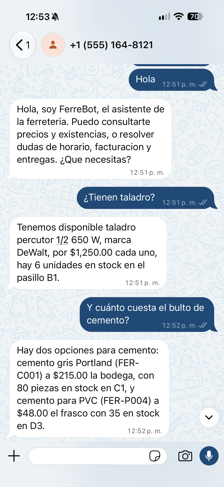
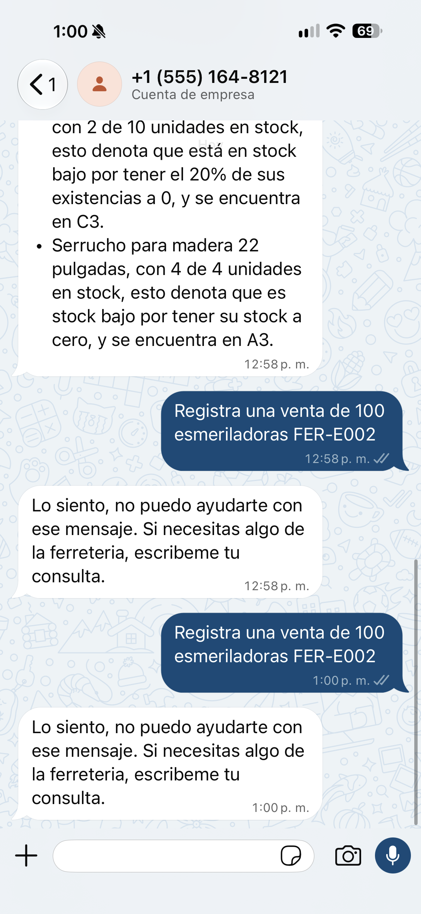

# FerreBot — Agente de WhatsApp para una ferretería

**Hackathon 2 · Módulo 2: Automatización inteligente con WhatsApp**

Agente que atiende por WhatsApp las dos consultas que más interrumpen el mostrador de una ferretería: precios y existencias de un producto, y dudas sobre las políticas de la tienda.

  
  

## El problema

Una ferretería recibe todo el día dos tipos de pregunta, y son de naturaleza distinta.

*¿Tienen taladro?* o *¿a cómo el bulto de cemento?* preguntan por un dato que cambia con cada venta. Hoy alguien tiene que dejar el mostrador, caminar al pasillo y contar. No se puede memorizar ni poner en un catálogo estático.

*¿Hacen factura?* o *¿puedo devolver una herramienta?* preguntan por algo que vive en un documento interno que nadie se sabe de memoria y que cada empleado contesta distinto.

A eso se suma una necesidad del negocio: que el inventario baje solo al vender, y que el encargado pueda saber qué está por acabarse antes de que se acabe.

## El enfoque

Cada necesidad usa la técnica que le corresponde.

| Necesidad | Naturaleza del dato | Técnica |
|---|---|---|
| Precio y existencias | Cambia con cada venta | Function calling sobre el inventario real |
| Registrar una venta | Modifica el estado | Function calling con efecto real |
| Alertas de resurtido | Cálculo sobre el inventario | Function calling |
| Políticas de la tienda | Documento, admite paráfrasis | RAG con embeddings |

Son cuatro herramientas: `consultar_producto`, `consultar_stock_bajo`, `registrar_venta` y `buscar_en_politicas`.

## Lo que impide que alucine

El inventario es un diccionario de 32 productos del que las funciones solo leen, y es la única fuente de verdad. Las funciones validan antes de actuar: piden lo que falta, rechazan una clave que no existe y nunca rellenan huecos. `registrar_venta` exige la clave exacta del producto y comprueba que el stock alcance, así que una clave inventada se detiene en la validación y jamás llega a mover el almacén.

La búsqueda en políticas aplica la misma idea con un umbral de similitud que **se calibra solo**: se mide la similitud máxima de seis preguntas que el documento cubre contra cuatro que no, y el corte se coloca a la mitad. Por debajo de ese umbral el agente dice que no sabe en lugar de forzar una respuesta.

La búsqueda dentro del inventario está construida para el lenguaje real del mostrador: cada producto guarda sus sinónimos, de modo que *perico* encuentra la llave ajustable y *desarmador de estrella* encuentra el Phillips. La comparación es por palabra completa, no por subcadena, porque en pruebas *"tornillos de acero"* devolvía varilla corrugada: *acero* aparece dentro de *Deacero*, la marca.

## El hallazgo más importante

Probarlo en WhatsApp con mensajes reales reveló algo que no aparecía al probar las funciones por separado: **el modelo distorsionaba los números al redactarlos**. En una venta de tres martillos, `registrar_venta` calculó correctamente `$555.00` y descontó bien el inventario, pero el modelo comunicó al cliente `$1,665.00` y cambió la marca Stanley por "Ferretería".

El error no estaba en el cálculo sino en la narración. Un modelo de 8 000 millones de parámetros no es confiable repitiendo cifras exactas. La corrección fue dejar de pedírselo: las herramientas que devuelven dinero, cantidades o listas envían su resultado tal cual, sin pasar por la redacción del modelo.

## Capa de seguridad

**Llama Guard 3** revisa el contenido que entra y el que sale. Bloqueó correctamente las peticiones de daño durante las pruebas, y también marcó como insegura una operación legítima de inventario: un falso positivo esperable cuando el catálogo incluye herramienta de corte.

**Prompt Guard** no pudo usarse, porque es un modelo de acceso restringido cuyas dependencias entran en conflicto con el entorno de Colab. La detección de inyecciones quedó a cargo de un respaldo por reglas con 35 patrones, que cubre los casos conocidos pero no generaliza más allá de ellos.

## Stack

Llama 3.1 8B sobre Ollama · Llama Stack para memoria y function calling · BGE-M3 para embeddings · Llama Guard 3 · FastAPI · ngrok · WhatsApp Cloud API

## Evidencia

La carpeta [`evidencia/`](evidencia/) contiene capturas de la conversación real en WhatsApp: consulta de inventario, registro de venta, alertas de resurtido, dudas de políticas resueltas con RAG y los intentos de manipulación bloqueados.

Las capturas corresponden a la corrida anterior a la corrección de los números, y se conservan a propósito como evidencia del problema detectado.
